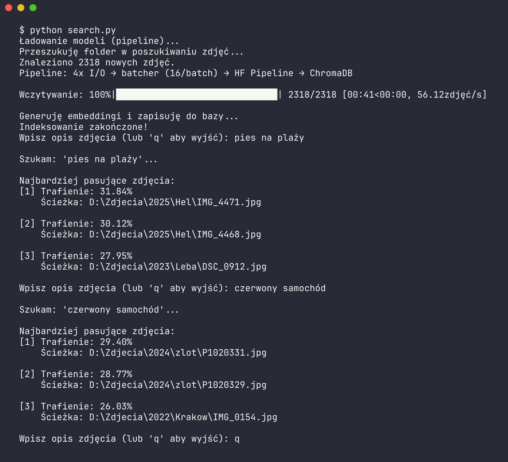

# 🔍 FileSearcher (wyszukiwarka zdjęć AI)

**FileSearcher** to program, który indeksuje zdjęcia na Twoim dysku przy użyciu sztucznej inteligencji (HF Transformers Pipeline + ChromaDB), pozwalając na późniejsze wyszukiwanie obrazów za pomocą naturalnych opisów tekstowych (zrozumiałych dla człowieka).



## ✨ Główne funkcje
- Szybkie indeksowanie tysięcy obrazów przy użyciu wielowątkowości.
- Przetwarzanie i kodowanie zdjęć w lokalnej bazie danych wektorowych (ChromaDB).
- Semantic search: wyszukiwanie zdjęć na podstawie opisów (np. "pies na plaży", "czerwony samochód").

## 🚀 Instalacja i użycie

1. **Zainstaluj wymagane pakiety:**
   W terminalu lub wierszu poleceń wpisz:
   ```bash
   pip install -r requirements.txt
   ```

2. **Skonfiguruj ustawienia:**
   Otwórz plik `config.json` i zdefiniuj ścieżkę folderu, który skrypt ma przeszukać (`FOLDER_ZE_ZDJECIAMI`), oraz dostosuj resztę parametrów.

3. **Uruchom program:**
   Rozpocznij indeksowanie obrazów wpisując:
   ```bash
   python search.py
   ```
   Przy pierwszym uruchomieniu poczekaj na zakończenie analizy zdjęć przez skrypt.

4. **Szukaj i baw się dobrze!**
   Gdy baza zostanie zbudowana, w wierszu poleceń pojawi się miejsce na Twoje zapytania. Wpisz to, czego szukasz, i ciesz się wynikami!

---

<sub>*projekt stworzony przy użyciu AI (claude opus 4.7, gemini 3.5 flash, gemini 3.1 pro (antigravity))*</sub>
